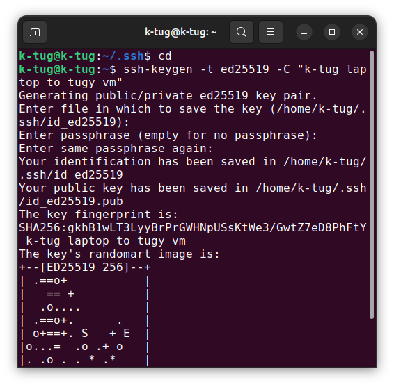
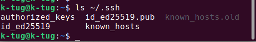
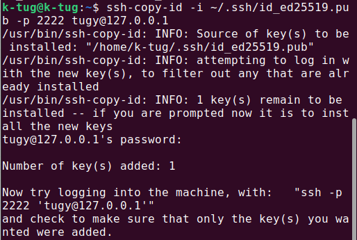
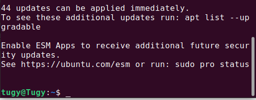
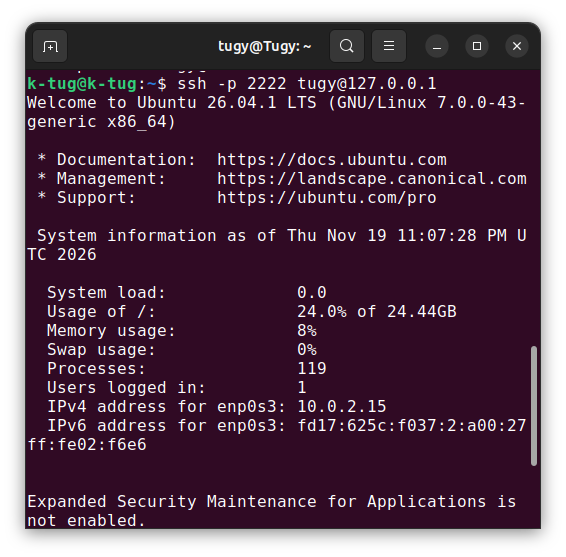
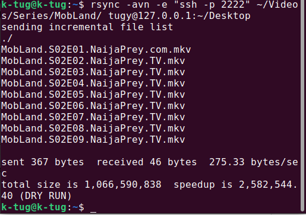

November 19,2026

Lab 03: ubuntu server ssh keys

Goal: Build an ubuntu server VM and practice how to connect to it remotely using ssh.

Setup

- Host: HP Elitebook 8460p laptop running Ubuntu 24.04 LTS
- VM software: Oracle VirtualBox
- Guest: Ubuntu Server 26.04.1 LTS
- Network: NAT with a port-forward rule (host: k-tug host ip: 127.0.0.1: host port: 2222, guest:tugy guest ip: none, guest port: 22)

What I Did:

- Created a "pre ssh" snapshot before connecting remotely using ssh
- Checked the .ssh folder to see if there were already generated keys and there was none
- Generated the ssh keys
- Copied the public key onto the server (VM)
- Logged in remotely to the VM using ssh
- Set up sftp again to check if the ssh key works and it did
- Transfer files using rsync and the ssh key worked without asking me for any password

Results:
- sftp works but doesn't ask for the VM's password but rather it asks for the ssh passphrase
- rsync works and also doesn't ask for a password it just
- Remotely access the vm through my terminal using ssh keys

Challenges
- Memorizing and understanding the commands needed to turn off password login

Screenshots

Watch the full lab recording

[Lab 03: SSH keys](https://youtu.be/AHXoUrgmO2Y)
