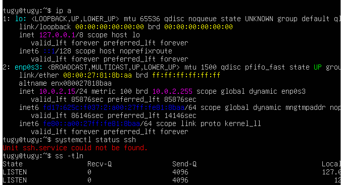
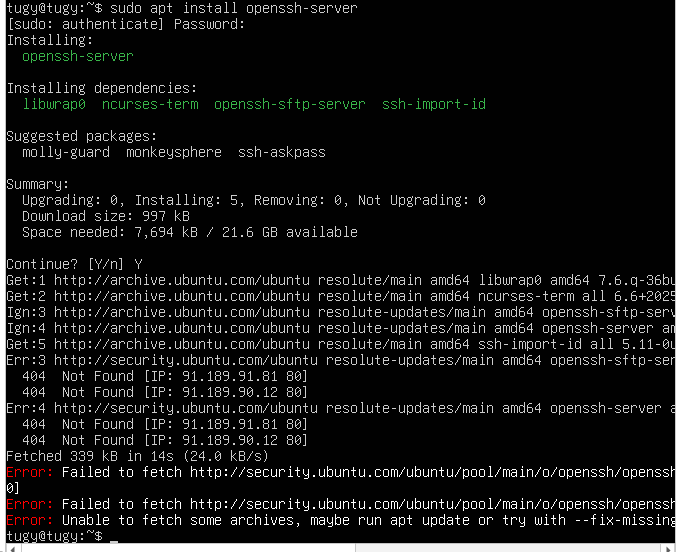
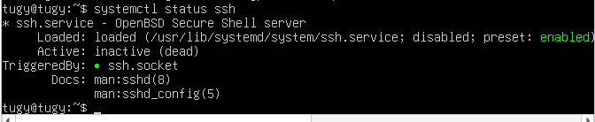
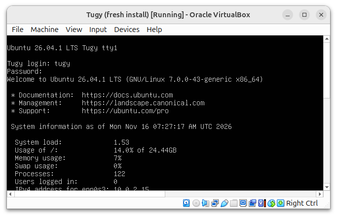
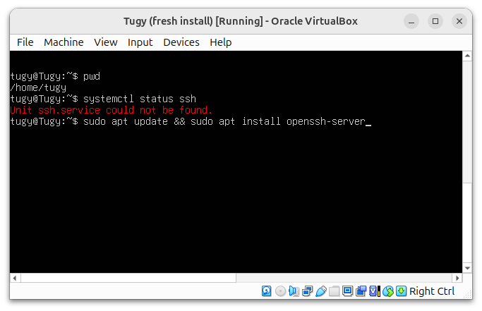
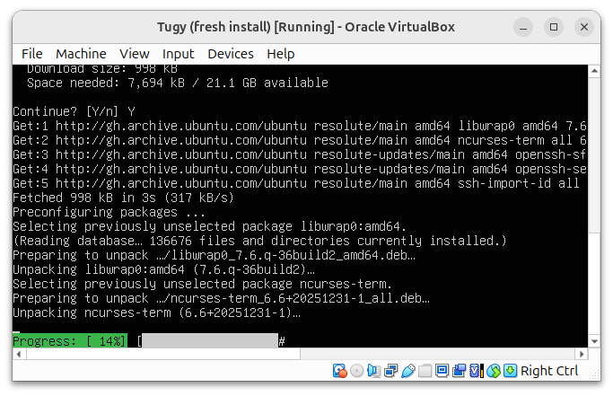
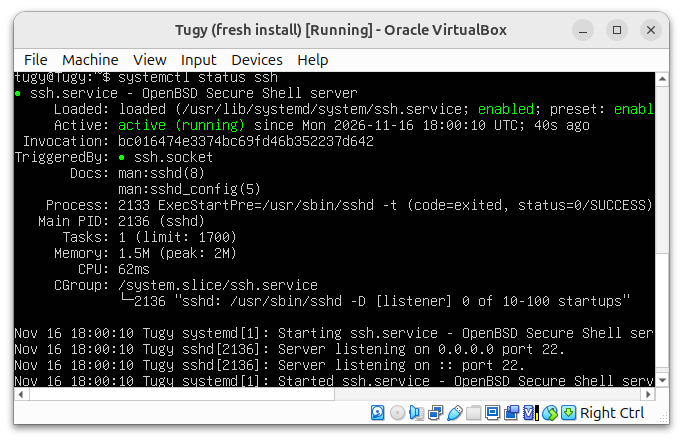
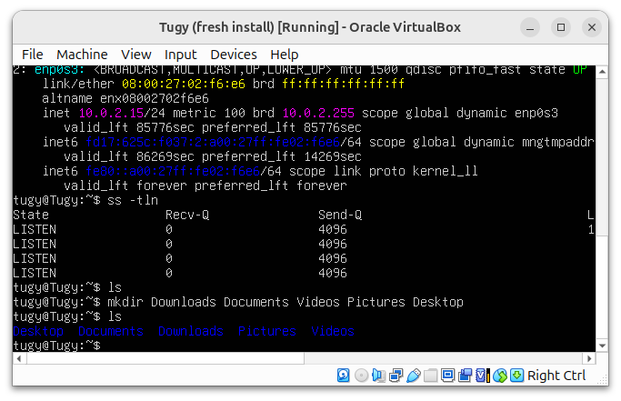
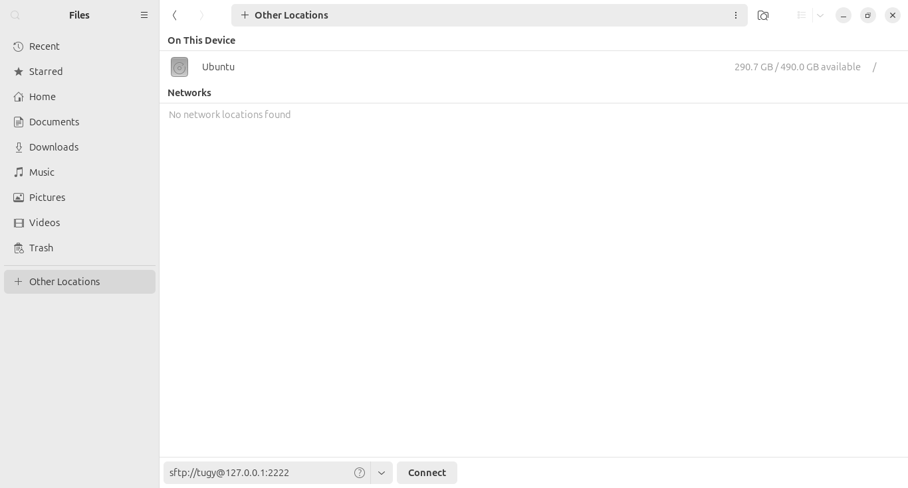

November 15, 2026.

Lab 01: Ubuntu Server VM with SFTP and rsync backups with the help Claude.

Goal
Build an Ubuntu Server VM and use it as a practice backup server:
transfer files over SFTP and sync folders with rsync.

Setup
- Host: HP Elitebook 8460p laptop running Ubuntu 24.04 LTS
- VM software: Oracle VirtualBox
- Guest: Ubuntu Server 26.04.1 LTS
- Network: NAT with a port-forward rule (host: tugy host ip: 127.0.0.1: host port: 2222 to guest port: 22)

What I did
1. Created the VM and added the port-forward rule.
2. Installed Ubuntu Server.
3. Took a snapshot (After install)
4. Installed and enabled OpenSSH server.
5. Created a folder structure on the server.
6. Connected over SFTP from the file manager.
7. Took a snapshot when I fixed the issues with sftp (sftp)
8. Used rsync for a dry run, a real copy, an unchanged re-run, and a
   one-file change.
9. Took another snapshot after running rsync to share files between my laptop (host) and the server (VM) (rsyn working)
10. Shut the VM down cleanly and took a snapshot.

Results
- SFTP worked in both directions. (screenshot)
- rsync's second run sent nothing, because nothing had changed. (screenshot)
- After editing one file, only that file was sent. (screenshot)

Problems and how I fixed them
1. VirtualBox error: kernel driver not installed (-1908)
- Cause: the VirtualBox driver wasn't rebuilt after a kernel update.
- Fix: finished the pending upgrade, rebooted, installed kernel headers
  and dkms, then re-ran the VirtualBox driver setup.

2. SFTP: "connection denied by server"
- Cause 1: the port-forward rule was missing.
- Cause 2: OpenSSH server wasn't installed on the VM.
- How I found it: checked the SSH service status on the VM and found
  the service didn't exist.

3. apt install failed with 404 errors
- Cause: the VM's package list was out of date.
- Fix: ran apt update, then installed again.

4. rsync path errors
- Cause: a missing space between source and destination, and a missing
  slash after the tilde.
- Fix: used a dry run to check the command before the real copy.

What I learned
- Why "connection refused" and "permission denied" point to different faults.
- Why a dry run matters before a real copy.
- How the trailing slash changes what rsync copies.

Limits and next steps
- Files still sit on the same laptop, so this is practice, not a backup.
- Still password-based. Next labs: firewall, then SSH keys.

I didn't know I was supposed to document this whole thing with screenshots and so I didn't take many, just these three so yeah.

Screenshots

Checking the ip address of the VM to see if the network stuff is working and then also seeing if openssh-server is installed and up

Installing ssh failed

Ssh installed successfully

November 16, 2026.

lab 01 - try 02: Ubuntu server on VM with sftp and rsync backups.

What i did:
PS: I took only one snapshot after the install unlike the first try.

- Created the VM, took a snapshot and logged in
- Checked if ssh was up and working
- Updated the apt package and installed ssh
- Checked if ssh was up after install
- Enabled ssh
- Created folder structure
- Transfer files via sftp from host to vm and vice versa
- Delete old ssh fingerprint (because I started the vm fresh and the fingerprint changed and I had to delete that and establish another one)
- Dry run rsync and accepted the fingerprint
- Actual run rsync to transfer files

Screenshots

Fresh ubuntu-server install to begin the lab.

Checked to see if ssh was installed but it wasn't and so I updated the apt package manager and installed ssh

Installing ssh

ssh installing in progress

.png)
Installed ssh successfully and running but it was dead

Ssh enabled and working successfully

Since the vm didn't come with directories in the home directory, I created some myself

Connecting to the vm via sftp using ssh

Files transferred from the host machine via sftp by just dragging and dropping from the host machine into the vm

Viewing the transferred file on the vm
